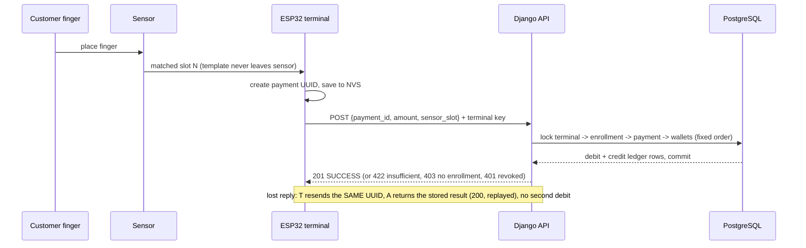

# Architecture

- **Backend:** Django + DRF + PostgreSQL (`payments/`). Three API surfaces: `/api/terminal/*` (terminal key, mock fingerprint), `/api/dev/mock/*` (shared token, dev only), `/api/*` (human sessions + CSRF; roles customer, merchant, admin come from server records).
- **Money:** one service (`services.py`): amounts are positive ints, wallets locked in pk order, debit+credit as two immutable ledger rows, payment UUID is the idempotency key, request mismatch is 409. Lock order terminal -> enrollment -> payment -> wallets. `reconcile()` checks opening + ledger == balance.
- **Identity:** the terminal sends a sensor slot; the server maps (terminal, slot) to an ACTIVE enrollment. Slots are never reused by self-enrollment. Revoked terminal/enrollment cannot create a transfer; an already-completed payment replays its stored result.
- **Audit:** `AuditEvent` rows for register, enroll, deletion request, revokes (append-only by convention).
- **Dev-only:** mock enrollment and merchant simulator need `DEBUG` and `BIOPAY_ENABLE_DEMO_API`; otherwise 404. Never enable on a shared host.
- **Web:** React 19 + TS + Vite + Tailwind. Landing (`/`) is public and API-independent: one persistent R3F canvas, scroll progress (GSAP ScrollTrigger) drives camera waypoints and per-scene visibility; no WebGL or reduced motion falls back to the plain HTML sections. App routes: /login /register /customer /customer/payments/:id /merchant /merchant/terminal /merchant/payments/:id /admin /admin/audit /demo.
- **Firmware:** `firmware/lib/payflow` (tested natively) behind hardware interfaces.

## Payment sequence (simulated BioCoins)

