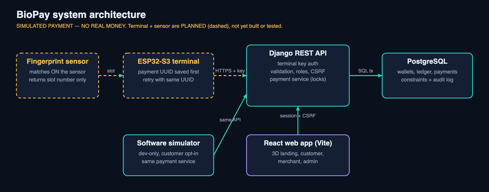
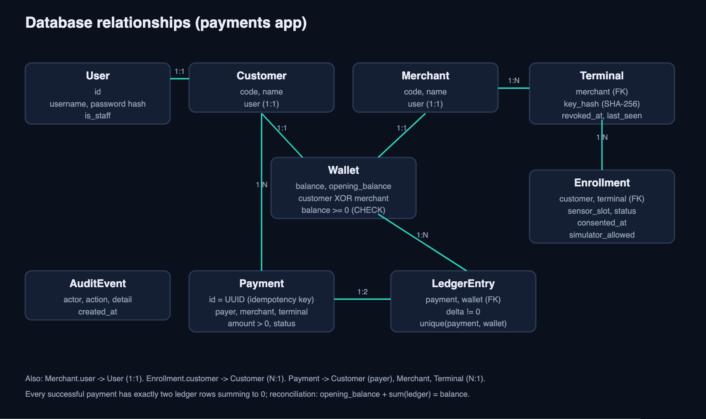
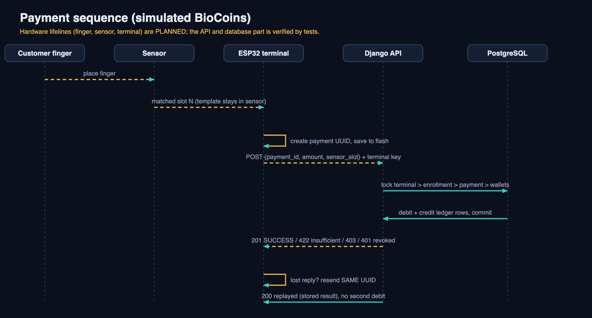
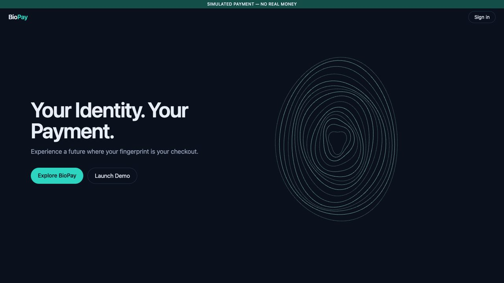
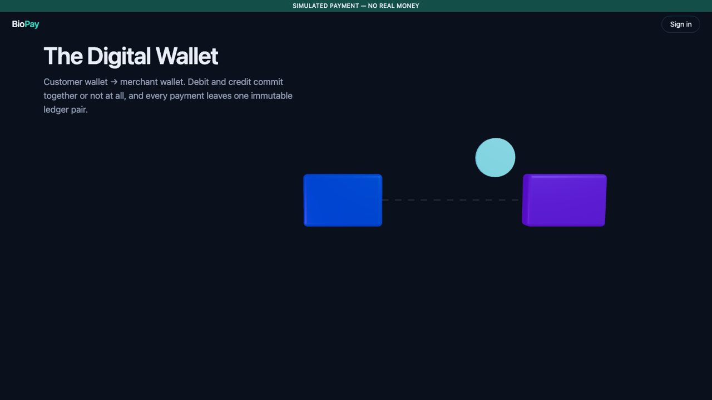
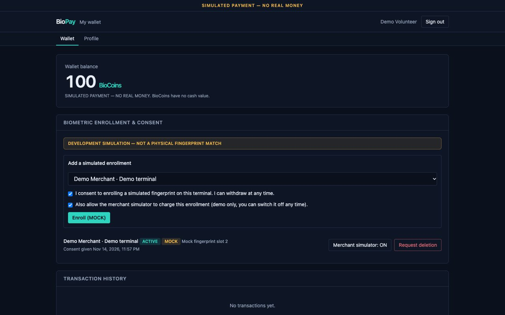
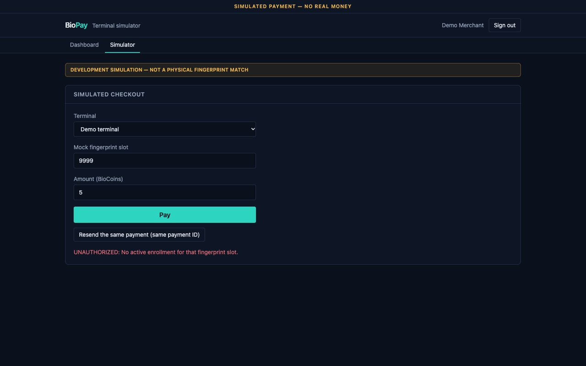
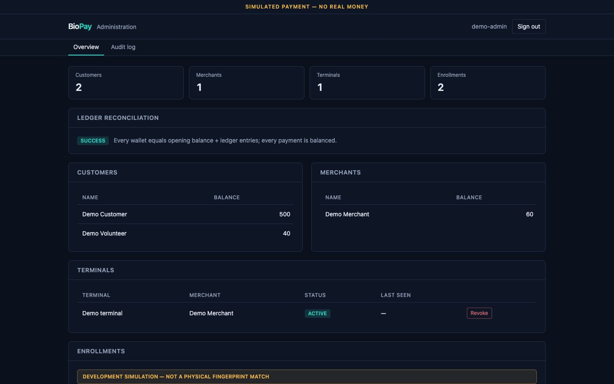
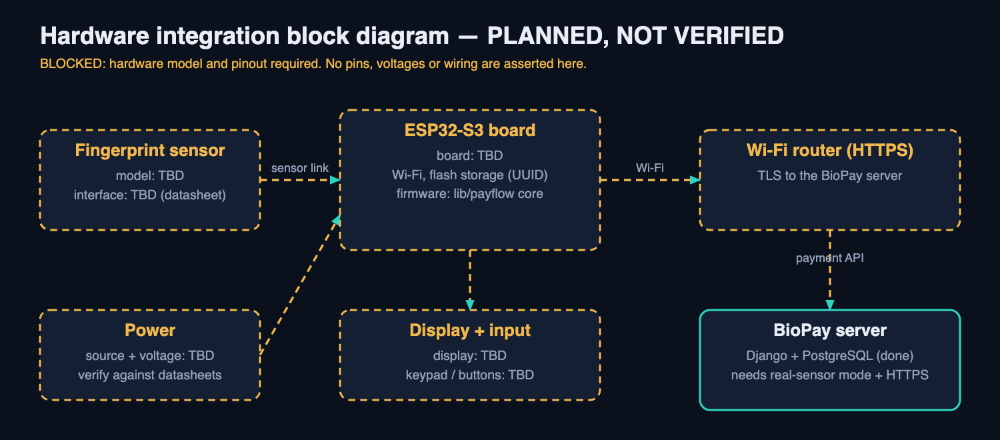

# BioPay: A Phone-Free Biometric Checkout Demonstration

Final Project Report (college IoT project)

Submitted by: ______________________  Roll no.: ____________

Guide: ______________________  Department / College: ______________________

Academic year: ____________

> **SIMULATED PAYMENT — NO REAL MONEY.** BioCoins are demo credits with no monetary value. The software is complete and tested; the physical fingerprint terminal has **not been built or tested yet**. Nothing in this report claims real fingerprint authentication.

## 1. Abstract

BioPay demonstrates how a customer could pay at a shop by placing a finger on a terminal instead of using a phone. A customer registers on a website, gives informed consent, and enrolls a fingerprint on a terminal. At checkout the terminal identifies the enrolled finger by a slot number and asks a server to move simulated BioCoins from the customer's wallet to the merchant's wallet. The server checks the terminal, the enrollment, the consent and the balance, and performs the transfer atomically in PostgreSQL. Customers, merchants and administrators each see their own view of the transactions.

This project delivers the complete software platform: a Django REST backend, a React web application with a cinematic Three.js landing page, a payment engine with idempotency and an audit log, a labelled software simulator, and a hardware-independent firmware core. It is verified by 105 backend tests, 18 browser tests and an end-to-end run on the real stack. The ESP32-S3 terminal and fingerprint sensor are planned and are listed as pending.

## 2. Introduction

Payments today depend on a phone, a card or cash. Biometric checkout removes the device but raises two engineering questions: how to move value safely when networks fail, and how to protect biometric data and consent. BioPay explores both questions in a safe classroom setting where no real money is involved.

## 3. Problem statement

A phone-based payment fails when the phone is lost, discharged or offline. A fingerprint-based payment removes the phone, but a careless design could charge a customer twice after a network failure, let a merchant charge the wrong person, store biometric templates on a server, or keep working after a customer withdraws consent. The problem is to design and prove a fingerprint-checkout flow that avoids these failures.

## 4. Objectives

1. Build a payment engine where every transfer is atomic and every payment is applied at most once.
2. Keep fingerprint templates off the server; the server sees only a sensor slot number.
3. Give customers, merchants and administrators separate, access-controlled views with an audit trail.
4. Make consent, withdrawal and revocation take effect immediately.
5. Verify the system with automated tests and a repeatable demonstration.
6. Prepare a clean interface so the real sensor and terminal can be connected later.

## 5. Existing system and limitations

| Existing approach | Limitation addressed by BioPay |
| --- | --- |
| Card or UPI with a phone | Needs a charged, connected phone |
| Biometric payment prototypes that upload templates | Server holds sensitive, unchangeable data |
| Simple "decrement balance" demos | No idempotency: a retry can charge twice; no ledger or reconciliation |
| Demos where the shop chooses the payer | A merchant can charge someone who did not agree |

## 6. Proposed solution

BioPay separates the problem into layers. The sensor matches fingers and reveals only a slot number. The terminal creates and stores a payment ID before sending anything and re-sends the same ID until it gets a definite answer. The server resolves the customer from the terminal and slot, locks the affected rows in a fixed order, writes a debit and a credit in one transaction, and stores the result under the payment ID so a repeat returns the same answer. Consent, revocation and role checks are enforced on the server.

## 7. System architecture

- **Web application (React 19, TypeScript, Vite).** Public 3D landing page and role-based dashboards.
- **API (Django 5, Django REST Framework).** Session login with CSRF for people; a separate device key for terminals.
- **Database (PostgreSQL).** Constraints enforce positive amounts and non-negative balances.
- **Terminal (planned).** ESP32-S3 with a fingerprint sensor; its payment logic is already written and tested on a laptop.

## 8. Technology stack

| Layer | Technology |
| --- | --- |
| Frontend | React, TypeScript, Vite, Tailwind CSS |
| 3D | Three.js, React Three Fiber, Drei, GSAP ScrollTrigger |
| Backend | Python 3.12, Django, Django REST Framework |
| Database | PostgreSQL |
| Testing | Django test runner, Playwright, axe-core, native C++ firmware tests |
| Firmware (planned) | ESP32-S3, C++ (payment core independent of hardware) |

## 9. Software and hardware requirements

**Software (used and verified):** macOS or Linux, Python 3.12, PostgreSQL 16 or newer, Node.js 20 or newer, a modern browser. Setup commands are in the README.

**Hardware (planned, not yet chosen):** an ESP32-S3 board, a fingerprint sensor with on-device matching, a display, and a keypad or buttons. Models, pins and voltages are **not decided** and are listed in the hardware handoff document.

## 10. Database architecture

Main tables: Customer, Merchant, Wallet, Terminal, Enrollment, Payment, LedgerEntry and AuditEvent. Important rules enforced by the database: a wallet belongs to exactly one customer or one merchant; balances cannot be negative; payment amounts are positive; a successful payment has exactly one debit and one credit entry that sum to zero; only one live enrollment can use a terminal slot. A reconciliation check recomputes `opening balance + ledger = balance` for every wallet.

## 11. Fingerprint enrollment and payment workflow

1. **Registration.** The customer registers and ticks consent; the server records the account and the starting BioCoins as the wallet's opening balance.
2. **Enrollment.** The sensor stores the template locally. The server stores only the terminal, the slot number, the status and the consent time. In the software demo a labelled mock enrollment replaces the sensor.
3. **Checkout.** The merchant enters an amount; the customer places a finger; the sensor returns a slot.
4. **Request.** The terminal sends the payment ID, amount and slot with its device key.
5. **Transfer.** The server finds the active enrollment for that terminal and slot, checks the balance, and commits the debit and credit together.
6. **Result.** The terminal shows success or failure; dashboards show the transaction.

## 12. Payment integrity and idempotency

- **Atomic transfer.** Debit and credit are written in one database transaction. If anything fails, neither is kept.
- **Fixed lock order.** Rows are locked in the order terminal, enrollment, payment, wallets (by id). Two payments cannot deadlock or both spend the same balance.
- **Idempotency.** The payment ID is the primary key. A second request with the same ID and the same details returns the stored result and does not charge again.
- **Conflict.** The same ID with different details is refused with a 409 conflict.
- **Revocation.** A revoked terminal or enrollment cannot start a payment. A payment already completed returns its original result when retried.
- **Declines.** Insufficient balance records a declined payment and moves nothing.

## 13. Privacy and consent

- No fingerprint image or template reaches the server. A slot number has meaning only together with its terminal.
- Registration requires an explicit consent tick; enrollment requires a second consent; the customer can request deletion at any time and an administrator completes it.
- Merchants see customers only as "Customer #n". Customers cannot read other customers' data.
- The software simulator can charge only enrollments whose owner has switched it on, and that check runs under the same database lock as the payment. The simulator exists only in development mode and must not be enabled on a shared host.
- Passwords are hashed and must be at least 12 characters and not common. Terminal keys are stored only as hashes. Sensitive actions are written to an audit log.

## 14. Implementation details

The landing page tells the story in six scenes (identity, scan, transaction, wallet, ecosystem, call to action). One persistent 3D canvas is driven by scroll position; a camera path and per-scene visibility are functions of scroll, so the animation is reversible. Without WebGL, or with reduced motion, the page falls back to plain sections.

The firmware payment core (`firmware/lib/payflow`) is plain C++ behind small interfaces for HTTP, storage, sensor and random numbers, so it is tested on a laptop. It saves the payment ID before sending, resends it on timeout or after a reboot, and clears it only after a definite answer.

## 15. Testing methodology

Tests are run in four layers: database and API tests with PostgreSQL (including concurrency), browser tests with a mocked API, an end-to-end run on the real stack with no mocks, and native tests of the firmware core. Accessibility is checked with axe-core, and horizontal overflow is checked at several screen widths.

## 16. Verified software results

The following were run on 2026-11-15 and are recorded in `TEST_REPORT.md`.

| Check | Result |
| --- | --- |
| Backend tests (PostgreSQL, concurrency included) | 105 passed |
| Browser tests (Playwright, API mocked, incl. axe on public pages) | 18 passed |
| Real-stack end-to-end run (Django, PostgreSQL, Vite) | all steps passed |
| Firmware core tests (native) | passed |
| TypeScript check and production build | clean |
| Lint | 0 errors |
| Accessibility (axe, WCAG 2 A/AA) on landing, login, register, customer, profile, merchant, simulator, merchant transaction detail, admin and audit pages | 0 violations |
| Horizontal overflow at 320, 390, 768, 1024, 1440, 1920 px on the main pages of every role (landing, login, register, customer, profile, merchant, simulator, admin, audit; not the transaction-detail pages) | none |

The real-stack run performs: register with consent; mock enrollment; a 60 BioCoin payment (success); the same payment ID again (replayed, charged once); a second 60 BioCoin payment (declined, insufficient balance); an unknown slot (refused); withdrawal of simulator consent (payment refused); admin reconciliation (consistent); audit log entries; and role isolation.

## 17. Hardware limitations

No sensor, board or terminal has been connected. The following are **not verified**: fingerprint enrollment and matching on a real sensor, wiring, flashing, Wi-Fi and HTTPS from the device, and a payment from a physical terminal. The terminal API currently runs only in development mode and needs a real-sensor mode and HTTPS before a device can use it.

## 18. Limitations

- Physical integration is pending.
- The audit log is append-only by convention, not by a database rule.
- The system was tested with tens of users on one server, not at scale.
- Accessibility was tested with automated tools and a keyboard test, not with a screen reader.
- The 3D page was checked with software rendering; real graphics-card performance was not measured.

## 19. Future scope

Real sensor integration and liveness checks, HTTPS with device certificates, hardware-backed key storage on the ESP32, refunds and receipts, database-level audit immutability, and load testing.

## 20. Conclusion

BioPay shows, with a verified software platform, how a fingerprint-checkout flow can keep biometric data off the server, charge exactly once under network failure, and respect consent and revocation. The remaining work is physical: connecting a real fingerprint sensor to an ESP32-S3 terminal and repeating the verified scenarios on the device.

## 21. References

1. Django documentation, https://docs.djangoproject.com/
2. Django REST framework documentation, https://www.django-rest-framework.org/
3. PostgreSQL documentation, "Explicit Locking" and "Transaction Isolation", https://www.postgresql.org/docs/
4. Three.js documentation, https://threejs.org/docs/
5. React Three Fiber documentation, https://r3f.docs.pmnd.rs/
6. Espressif, ESP32-S3 documentation, https://docs.espressif.com/
7. W3C, Web Content Accessibility Guidelines (WCAG) 2.1, https://www.w3.org/TR/WCAG21/
8. IETF RFC 9562, Universally Unique Identifiers (UUIDs), https://www.rfc-editor.org/rfc/rfc9562
9. Stripe documentation, "Idempotent requests" (a widely used description of the idempotency-key pattern), https://docs.stripe.com/api/idempotent_requests

## 22. Viva questions and answers

**Why not store the fingerprint on the server?** A leaked template cannot be changed like a password. Matching on the sensor means the server only receives a slot number.

**What stops a double charge when Wi-Fi drops?** The terminal creates a payment ID and saves it before sending. A retry reuses it, and the server uses the ID as a unique key and returns the stored result.

**What if two payments hit one wallet at the same time?** Wallets are locked in a fixed order inside one transaction, so the payments queue, and a database rule forbids negative balances.

**What if a terminal is stolen?** An administrator revokes it. Payments lock the terminal row, so a payment either finishes before revocation or is refused after.

**Can a merchant choose whom to charge?** The terminal sends only a slot; the server resolves the person. The software simulator needs the customer's opt-in for that enrollment and exists only in development mode.

**What if a sensor slot is deleted and reused?** Software enrollments never reuse a slot number, and records are scoped to a terminal and carry a status, so an old record cannot silently point to a new person.

**How do you know balances are correct?** Reconciliation recomputes opening balance plus ledger for every wallet and checks that each payment sums to zero. An administrator can run it at any time.

**Is this real money?** No. BioCoins are simulated and every payment screen says so.

**What is not proven yet?** Everything physical: real sensor matching, device wiring, and the terminal-to-server link on hardware.

**Why a simulator?** To test the whole software chain before the hardware exists. It is labelled and gated to development mode.

**Why PostgreSQL?** It provides row locks, transactions and constraints that make the payment rules enforceable by the database itself.
